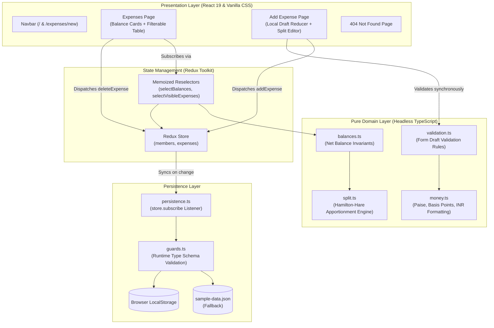

# ✈️ Trip Splitter

[](https://react.dev/)
[](https://www.typescriptlang.org/)
[](https://redux-toolkit.js.org/)
[](https://vitejs.dev/)
[](https://vitest.dev/)
[](https://eslint.org/)

> A modern group travel expense-sharing web application built for five friends returning from a trip to Goa. Designed with strict domain-driven TypeScript, Redux Toolkit, reactive browser persistence, and accessible semantic UI.

---

## 📸 Overview & Features

Five friends (**Aarav, Diya, Kabir, Meera, and Rohan**) returned from Goa with shared expenses: villa reservations, beach shack dinners, scuba diving, scooter rentals, and airport cabs. Trip Splitter settles all debits and credits with zero lost paise and complete transparency.

- 📊 **Trip Balances Dashboard**: Live cards indicating each member’s net financial standing (`gets back ₹X`, `owes ₹X`, or `settled up`).
- 🧾 **Interactive Expense Ledger**: Real-time table sorted newest-first with descriptions, dates, categories, payers, amounts, and split summaries.
- 🏷️ **Dynamic Category Filtering**: Instant filtering (`Food`, `Travel`, `Stay`, `Activities`, `Other`) with a live-updating running total and custom empty states.
- 🧮 **Three Flexible Split Models**:
  - **Equally**: Split evenly among any subset of members with mathematical remainder apportionment.
  - **Exact Amounts**: Allocate exact ₹ amounts per person with live remaining balance feedback.
  - **Percentages**: Allocate exact percentage shares with basis point precision totaling 100%.
- 🛡️ **Zero-Loss Financial Guarantee**: Implements the Hamilton-Hare apportionment algorithm; net balances across all members always sum to exactly **₹0.00**.
- 💾 **Resilient Browser Storage**: Auto-saves to `localStorage` with exhaustive runtime type validation and graceful fallback to `sample-data.json`.
- ♿ **Accessible & Responsive**: Keyboard navigable, visible labels, ARIA landmarks and live alerts, responsive down to 360px viewport width.

---

## 🏗️ Architecture & Data Flow



---

## 🚀 Quickstart: Clone & Run

### Prerequisites
- **Node.js**: v18.0.0 or higher
- **npm**: v9.0.0 or higher

### Installation & Launch
```bash
# 1. Clone repository
git clone https://github.com/jeevanL16/Trip-Splitter.git
cd Trip-Splitter

# 2. Install dependencies
npm install

# 3. Start local development server
npm run dev
```

Navigate to **`http://localhost:5173`** in your browser.

### Quality Verification Commands
| Script | Command | Purpose |
| :--- | :--- | :--- |
| **Unit & Integration Tests** | `npm run test` | Executes all 106 automated tests via Vitest |
| **TypeScript Typecheck** | `npm run typecheck` | Strict compiler checks with zero `any` or `@ts-ignore` |
| **ESLint Validation** | `npm run lint` | ESLint flat config with jsx-a11y and typescript-eslint |
| **Production Build** | `npm run build` | Compiles and optimizes assets into `/dist` |

---

## ⚖️ Rounding & Apportionment Rule

To satisfy the invariant that **splitting never loses or invents a single paisa**, this application implements the **largest-remainder method (Hamilton-Hare algorithm)**:

1. **Integer Representation**: All monetary values are handled as integer paise (e.g. ₹100 = `10000` paise).
2. **Base Allocation**: Each participant is assigned an initial integer base share:
   $$\text{base}_i = \lfloor \frac{\text{amount} \times \text{weight}_i}{\text{total weight}} \rfloor$$
3. **Remainder Distribution**: Leftover paise from integer truncation are distributed one-by-one to participants with the highest fractional remainders:
   $$\text{rem}_i = (\text{amount} \times \text{weight}_i) \pmod{\text{total weight}}$$
4. **Deterministic Tie-Breaking**: When remainders are tied, the extra paisa is awarded following the trip member order:
   $$\text{Aarav} \rightarrow \text{Diya} \rightarrow \text{Kabir} \rightarrow \text{Meera} \rightarrow \text{Rohan}$$

### Concrete Example: ₹100 Split Equally Among 3 Friends
$$\frac{10000 \text{ paise}}{3} = 3333 \text{ paise with remainder } 1$$
- **Aarav**: $3333 + 1 = 3334 \text{ paise} = \mathbf{₹33.34}$
- **Diya**: $3333 + 0 = 3333 \text{ paise} = \mathbf{₹33.33}$
- **Kabir**: $3333 + 0 = 3333 \text{ paise} = \mathbf{₹33.33}$
- **Total**: $₹33.34 + ₹33.33 + ₹33.33 = \mathbf{₹100.00}$ (Exactly ₹0.00 lost)

---

## 🧠 Key Engineering Decisions

### 1. Zero Floating-Point Math in Domain Calculations
- **Problem**: IEEE-754 floating-point operations introduce subtle rounding errors (e.g. `0.1 + 0.2 = 0.30000000000000004`).
- **Solution**: All financial calculations use integer paise (`125050` = `₹1,250.50`), and percentage allocations use integer basis points (`3333` = `33.33%`). Formatting to Indian numbering (`formatINR`) occurs solely at the presentation boundary.

### 2. Isolated Storage Engine with Runtime Validation
- **Problem**: Direct `localStorage` reads/writes inside components violate separation of concerns and crash upon schema corruption.
- **Solution**: Persistence is isolated in `src/app/persistence.ts`. The initial state hydrates once during Redux setup. Store subscriptions (`store.subscribe`) persist state only when `state.expenses` changes. All inputs pass through exhaustive runtime guards (`parsePersistedState`) before entering Redux, falling back to `sample-data.json` without unsafe `as` casts or non-null assertions (`!`).

### 3. Local Draft State (`useReducer`) with Synchronous Error Derivation
- **Problem**: Storing raw unvalidated form drafts in Redux pollutes global state and creates state synchronization drift.
- **Solution**: Form inputs remain in component-local reducer state. Redux only receives sanitized, validated `NewExpense` records. Errors are derived synchronously on render through the pure function `validateExpenseDraft(draft, ctx)`, ensuring immediate accessible error feedback on submit.

---

## 🧪 Comprehensive Automated Test Suite (106 Tests)

```
Test Files  11 passed (11)
Tests       106 passed (106)
```

| Test Suite | Tests | Key Invariants Covered |
| :--- | :---: | :--- |
| `src/domain/money.test.ts` | 33 | Paise conversion, decimal constraints, negative prevention, Indian grouping format (`₹1,00,000.00`) |
| `src/domain/split.test.ts` | 5 | Hamilton-Hare engine, ₹100 split 3 ways, basis point allocation, invariant balance conservation |
| `src/domain/balances.test.ts` | 5 | Multi-expense balance aggregation, zero-sum conservation ($\sum \text{balances} = 0$), credit/debit tracking |
| `src/domain/validation.test.ts` | 24 | Description length ($\le 60$), future date rejection, sum verification, remainder error string generation |
| `src/domain/guards.test.ts` | 6 | Structural validation, rejection of malicious/corrupted payloads, safe object type checking |
| `src/domain/dates.test.ts` | 3 | ISO 8601 validation, calendar integrity, timezone-safe future date prevention |
| `src/app/persistence.test.ts` | 5 | Redux subscriber persistence, round-trip serialization, missing/corrupt storage recovery |
| `src/features/expenses/expensesSlice.test.ts` | 4 | Redux slice state transitions (add expense with generated UUID, delete expense) |
| `src/App.test.tsx` | 3 | Route transitions, active navigation link state (`aria-current="page"`), 404 fallback routing |
| `src/pages/ExpensesPage/ExpensesPage.test.tsx` | 8 | Newest-first sorting, category filtering, confirmation modal cancellation and deletion |
| `src/pages/AddExpensePage/AddExpenseForm.test.tsx` | 10 | Real-time inline field errors, keyboard focus redirection, successful save with flash message |

---

## 📂 Project Directory Structure

```
trip-splitter/
├── src/
│   ├── app/                    # Store configuration, persistence listener, typed hooks
│   │   ├── hooks.ts            # useAppDispatch, useAppSelector
│   │   ├── persistence.ts      # localStorage sync & sample data bootstrap
│   │   └── store.ts            # Redux Toolkit store setup
│   ├── components/             # Reusable accessible UI components
│   │   ├── ConfirmDialog.tsx   # Modal confirmation dialog for deletions
│   │   ├── EmptyState.tsx      # Clear visual empty state representations
│   │   ├── FormField.tsx       # Accessible input wrapper with inline field error alerts
│   │   ├── Layout.tsx          # App shell wrapper
│   │   └── Navbar.tsx          # Accessible navigation header with active page indicator
│   ├── data/
│   │   └── sample-data.json    # Initial trip expenses and member dataset
│   ├── domain/                 # Headless, framework-agnostic domain logic
│   │   ├── balances.ts         # Net balance calculation engine
│   │   ├── dates.ts            # ISO date validation and timezone helpers
│   │   ├── describe.ts         # Natural language split summary formatters
│   │   ├── guards.ts           # Exhaustive runtime type guard assertions
│   │   ├── money.ts            # Integer paise math & Indian numbering formatter
│   │   ├── split.ts            # Largest-remainder (Hamilton-Hare) allocation
│   │   ├── types.ts            # Strict domain TypeScript models & type unions
│   │   └── validation.ts       # Pure form draft validator
│   ├── features/
│   │   └── expenses/           # Redux slice, actions, and memoized selectors
│   ├── pages/
│   │   ├── AddExpensePage/     # Form interface, split editor, draft reducer
│   │   ├── ExpensesPage/       # Ledger, balance cards, category filter
│   │   └── NotFoundPage.tsx    # 404 error page with navigation link
│   ├── styles/                 # Design tokens (colors, typography, spacing) & base styles
│   └── main.tsx                # Application entrypoint
├── index.html
├── package.json
├── tsconfig.json               # Strict TypeScript configuration
└── vite.config.ts              # Vite + Vitest configuration
```

---

## 🔮 What I’d Build With Another Day

1. **Greedy Debt Simplification**: Implement a minimum-cash-flow graph algorithm (e.g. matching maximum debtor to maximum creditor) to compute the minimal number of direct transfers to settle all trip debts.
2. **Expense Editing & History**: Add full editing capability for existing expenses with automatic pre-population of the form and instant balance updates.
3. **Deep Linking for Filters**: Synchronize category filter states into URL search parameters (`/?category=Food`) for shareable, bookmarkable filtered views.
4. **Multi-Tab Sync**: Add a listener for the browser `storage` event to ensure balances and ledger items automatically synchronize when modified in other browser tabs.

---

## 🤖 AI Usage Disclosure

- **Claude**: Consulted during the initial system design and research phase to explore domain boundary isolation, analyze edge-case behaviors of the Hamilton-Hare apportionment algorithm versus basis points, and outline edge-case test matrices.
- **Google Antigravity**: Utilized during the implementation and verification phase to author strict TypeScript components, structure the 106-test automated verification suite, validate build artifacts, and perform automated interactive browser verification.